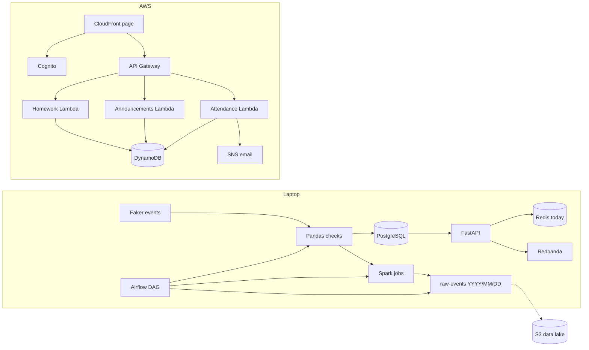

# EduConnect

Hello, welcome to EduConnect. Designed by Siphesihle Madalane.

EduConnect is a small school-data platform. A teacher records a fake attendance mark. That mark is stored, checked, streamed, summarised, and, when a learner is absent, emailed. Parents can sign in and read school announcements and homework. Every name in this project is invented with Faker. Do not put real pupils, parents, or ID numbers in it.

Schools generate the same facts every day: who came, who was late, who scored what. Those facts sit in registers, spreadsheets, and inboxes, so a parent finds out late and a teacher cannot see a class at a glance. EduConnect exists to show one path for that data: into a database, through a stream, into a nightly batch, and out to a small signed-in page in the cloud.

This repo is the capstone for the WeThinkCode_ cloud computing and data engineering electives. The laptop half is the data pipeline. The AWS half is a serverless API and page. Both use the same fake school.

The project currently has these slices:

1. A database shape and a Python script that invents a school.
2. PostgreSQL in Docker, a loader for that school, and a small API that records attendance.
3. A Pandas quality report, and Redis for today's attendance.
4. Redpanda, so each attendance mark is also published to a stream.
5. Spark jobs for the weekly attendance rate of each class, and for grade distribution.
6. An Airflow DAG that runs the check, both Spark jobs, and the date-folder export.
7. An AWS API for attendance, announcements, and homework, defined in SAM, with Cognito login and roles.
8. An upload of the date folder to the S3 data lake.
9. Debezium, which copies every PostgreSQL change onto Redpanda, and a stream job that counts absences per class.
10. A second source: a CSV of re-marked grades that arrives on an SFTP server.
11. dbt models and tests over PostgreSQL.
12. API routes that serve the Spark reports and the live absence counts.

Learner names in this project come from Faker. Do not replace them with real pupils, parents, or ID numbers.

## Run the generator

From the project root:

```bash
python -m pip install -r requirements.txt
python src/generator/produce_events.py
```

That writes `data/generated/events.json`. The file holds teachers, learners, classes, enrollments, assignments, and the events. The same command with the same seed writes the same school. Generated files stay on your machine; they are listed in `.gitignore`.

Useful options:

```bash
python src/generator/produce_events.py --students 20 --days 5 --seed 42
```

## Load the school into PostgreSQL

Docker Desktop or the Docker engine needs to be running.

```bash
docker compose up -d
python src/loader/load_events.py
```

The loader rebuilds the tables from `sql/schema.sql` and inserts the JSON file. Running it again replaces the rows. The database password in `docker-compose.yml` is for this local demo only.

Stop the database with `docker compose down`. Add `-v` when you also want to delete the saved data.

## Check data quality

```bash
python src/quality/check_events.py
```

This reads the generated events with Pandas and prints PASS or FAIL for three rules: every event has a `student_id`, attendance status is `present`, `absent`, or `late`, and each grade is between 0 and that assignment's maximum. Load the file after the report says PASS.

## Run the API

```bash
python -m uvicorn api:app --app-dir src --port 8000
```

Open http://127.0.0.1:8000/docs . `POST /attendance` accepts the same JSON as `data/samples/attendance_event.json`. Posting the same learner, class, and day again updates that mark.

Read one learner back from PostgreSQL:

```bash
curl http://127.0.0.1:8000/students/1001/attendance
```

Today's marks come from Redis, which `docker compose up -d` starts with PostgreSQL:

```bash
curl http://127.0.0.1:8000/attendance/today
curl "http://127.0.0.1:8000/attendance/today?student_id=1001"
```

`POST /attendance` writes the row to PostgreSQL, stores today's mark in Redis, and publishes the event to Redpanda.

Watch the stream in a second terminal:

```bash
python src/listen_attendance.py
```

Post an attendance mark, and that terminal prints the learner, class, and status.

## Weekly attendance

Spark runs on this laptop. It does not need a cluster. This job uses Spark 3.5, which needs Java 17. On this machine the script finds Java 17 by itself.

```bash
python src/batch/weekly_attendance.py
```

The script reads the generated events and writes `data/generated/weekly_attendance.json`. Present and late count as attended. Each row is one class for one week, and the week starts on Monday.

## Grade distribution

```bash
python src/batch/grade_distribution.py
```

Each score becomes a percentage of that assignment's maximum. The report lists the average percentage per class, and how many grades fall into `0-49`, `50-59`, `60-69`, `70-79`, and `80-100`. The file is `data/generated/grade_distribution.json`.

## Date folders for the data lake

```bash
python src/batch/export_lake.py
```

This copies the raw events and both Spark reports into `data/lake/raw-events/YYYY/MM/DD/`. That is the same layout the project will later use at `s3://educonnect-data-lake/raw-events/YYYY/MM/DD/`. The folder is gitignored.

## Nightly Airflow job

Airflow is installed beside the main packages, because it has its own dependency list.

```bash
python -m pip install -r requirements-airflow.txt
export AIRFLOW_HOME="$PWD/.airflow"
export AIRFLOW__CORE__DAGS_FOLDER="$PWD/dags"
export AIRFLOW__CORE__LOAD_EXAMPLES=false
airflow db migrate
airflow dags test educonnect_nightly 2026-10-15
```

The DAG `educonnect_nightly` runs four steps in order: the Pandas check, weekly attendance, grade distribution, then the date-folder export. It is scheduled for 02:00 every day. `dags test` runs that pipeline once, immediately, so you can show it without waiting until 02:00.

## Upload the date folder to S3

After `export_lake.py` has written today's folder, and with the AWS CLI signed in to the account that holds the stack:

```bash
python -m pip install -r requirements.txt
python src/batch/upload_lake.py
```

The script finds your account id and copies `data/lake/raw-events/YYYY/MM/DD/` to the same path in `educonnect-data-lake-<account id>`. Pass `--bucket` or `--day 2026-10-15` to change either. To make Airflow do it as a fifth task, set `EDUCONNECT_UPLOAD_TO_S3=1` before you start Airflow. Without that variable the DAG has four tasks and needs no AWS login.

## Change data capture with Debezium

Debezium reads the PostgreSQL write-ahead log and publishes every insert, update, and delete on `attendance` and `grades` to Redpanda. The topics are `educonnect.public.attendance` and `educonnect.public.grades`. PostgreSQL runs with `wal_level=logical`, and `sql/schema.sql` sets `REPLICA IDENTITY FULL` on `attendance` so an update carries the old row too.

Order matters, because the loader drops and recreates the tables:

```bash
docker compose up -d
python src/generator/produce_events.py
python src/loader/load_events.py
python src/streaming/register_connector.py
python src/streaming/register_connector.py --status
```

Kafka Connect needs about a minute to start. After the connector registers, Debezium first sends every existing row (operation `r`), then each new change. If you run the loader again, use `python src/streaming/register_connector.py --reset` afterwards. If the connector still complains, `docker compose down -v` wipes everything and you can start again.

Look at the stream in the Redpanda container:

```bash
docker exec -it educonnect-redpanda rpk topic consume educonnect.public.attendance -n 3
```

`POST /attendance` still publishes to the `attendance` topic itself. That is a second path for the same fact, kept so `listen_attendance.py` keeps working. The change stream is the one that stays correct when a mark is edited.

## Count absences from the stream

```bash
python src/streaming/absence_counter.py
```

The job reads `educonnect.public.attendance` and keeps a running count of absences per class and day in Redis. Marking a learner absent adds one. Correcting that mark to present takes it away again, because the update carries the old row. Read the counts from the API:

```bash
curl "http://127.0.0.1:8000/classes/absences?attendance_date=2026-10-12"
```

## A second source: grades on SFTP

`docker compose up -d` also starts a small SFTP server on `localhost:2222`. Its upload folder is `data/sftp` on this machine. The user and password are both `educonnect`, for this demo only.

```bash
python -m pip install -r requirements.txt
python src/ingest/make_sample_upload.py
python src/ingest/sftp_grades.py
```

The first script writes `data/sftp/grades_upload.csv`, which re-marks eight generated grades. The second downloads every CSV from the server, checks the rows, and upserts them into `grades`. A score above its assignment's maximum fails the whole file, and nothing loads. Try that with `make_sample_upload.py --bad`. If Debezium is running, the corrected scores appear on `educonnect.public.grades`.

## dbt models and tests

dbt runs against the local PostgreSQL and writes to a schema called `analytics`. It has its own dependency list.

```bash
python -m pip install -r requirements-dbt.txt
dbt build --project-dir dbt --profiles-dir dbt
```

`stg_attendance` and `stg_grades` clean the tables. Three marts give the same answers as the Spark jobs: `attendance_weekly_by_class`, `grade_averages_by_class`, and `grade_bands_by_class`. The source tests check keys, relationships, and the allowed attendance statuses. Two extra tests in `dbt/tests/` check that an attendance rate stays between 0 and 1 and that no score is above its maximum.

## Serve the reports from the API

```bash
curl http://127.0.0.1:8000/reports/weekly-attendance
curl "http://127.0.0.1:8000/reports/grade-distribution?class_id=10"
```

The API reads the newest folder under `data/lake/raw-events/`, which is the folder Airflow just exported. The answer says which folder it came from. Before any lake folder exists it reads `data/generated/` instead.

## Run the tests

The tests use the project virtualenv. They do not need PostgreSQL, Redis, or AWS.

## Architecture



## What is built, and what is not

| Built | Not built (say this in the demo) |
| --- | --- |
| Local pipeline: Faker, 3NF PostgreSQL, Redis, Redpanda, Spark, Airflow, lake folders | A parent-to-child link, so a parent would only see their own learners |
| AWS SAM: API Gateway, Lambda, DynamoDB, Cognito groups, SNS email, S3, CloudFront, CloudWatch alarm | Timetables, messaging, and reports on AWS; grades in the AWS API |
| Page: sign-in, attendance lookup and mark form, announcements, homework | ECS (Lambda is the cloud compute); Athena or Glue over the lake |
| Tests for the quality rules, Lambdas, lake export, and stream helpers | |

Homework and the teacher-only attendance read live in this repo. They need one `sam deploy` before the live API serves them. Until then the live stack still has attendance and announcements only.

Demo helpers:

```bash
bash scripts/demo_pipeline.sh
bash scripts/demo_cloud.sh
```

```bash
.venv/bin/python -m unittest discover -s tests -v
```

## AWS API: attendance and announcements

This slice runs in an AWS account, not in Docker. The template creates two private S3 buckets, two DynamoDB tables (attendance and announcements), an SNS email topic, two Lambdas, an HTTP API, a Cognito login with three groups (`admin`, `teacher`, `parent`), a CloudFront page, and a CloudWatch error alarm. There is no EC2, RDS, NAT gateway, or SMS.

From the project root, with the AWS CLI and SAM CLI logged into the account you will use for the demo:

```bash
sam validate -t infra/template.yaml --lint
sam build -t infra/template.yaml
sam deploy --stack-name educonnect --region eu-north-1 \
  --capabilities CAPABILITY_IAM --resolve-s3 --confirm-changeset \
  --parameter-overrides AlertEmail=you@example.com
```

Use your own email. After the stack finishes, open the email from AWS and confirm the subscription. The stack in this project is deployed in `eu-north-1` (Stockholm). Use the same region for every `aws` command.

The API has no stage prefix, so the base URL is the `ApiUrl` output as it is. Every route needs a Cognito id token. The groups in that token decide who may write:

| Route | Who may call it |
| --- | --- |
| `POST /attendance` | `teacher`, `admin`. An `absent` mark also sends one email. |
| `GET /attendance/today` | Any signed-in user. Marks are not yet limited to a parent's own children, so use fake learners only. |
| `POST /announcements` | `teacher`, `admin`. One whole-school announcement. |
| `GET /announcements` | `parent`, `teacher`, `admin`. Newest first. |

`POST /attendance` uses the same JSON as `data/samples/attendance_event.json`. An announcement body is `{"title": "...", "body": "..."}`, with a title up to 100 characters and a message up to 1000.

The data-lake bucket is named `educonnect-data-lake-<account id>`. It stays private. Objects belong under `raw-events/YYYY/MM/DD/`, the same layout as `data/lake/` on the laptop.

Create a user, set a password, and put the user in a group. Type the password at the prompt so it does not stay in your shell history:

```bash
POOL=USER_POOL_ID   # from the UserPoolId output
aws cognito-idp admin-create-user --region eu-north-1 --user-pool-id $POOL \
  --username you@example.com \
  --user-attributes Name=email,Value=you@example.com Name=email_verified,Value=true \
  --message-action SUPPRESS
read -s -p "Password: " PW; echo
aws cognito-idp admin-set-user-password --region eu-north-1 --user-pool-id $POOL \
  --username you@example.com --password "$PW" --permanent
unset PW
aws cognito-idp admin-add-user-to-group --region eu-north-1 --user-pool-id $POOL \
  --username you@example.com --group-name teacher
```

The group is written into the token when you sign in, so sign in again after changing a user's group.

The page lives in `web/index.html`. CloudFront serves it from the private `educonnect-web-<account id>` bucket. After deploy, check that `clientId` and `apiUrl` in that file match the stack outputs, then upload it and clear the CloudFront cache:

```bash
aws s3 sync web/ s3://educonnect-web-ACCOUNT --delete
aws cloudfront create-invalidation --distribution-id DISTRIBUTION_ID --paths "/*"
```

Open the `SiteUrl` output and sign in.

The alarm `educonnect-attendance-errors` emails the same SNS address if the attendance Lambda reports an error.

Delete the stack after the demo. Empty both buckets first if you uploaded files:

```bash
sam delete --stack-name educonnect --region eu-north-1
```

## What to open first

| File | Why it is there |
| --- | --- |
| `sql/schema.sql` | PostgreSQL tables in third normal form. |
| `data/samples/attendance_event.json` | One attendance event in the shape the API accepts. |
| `src/generator/produce_events.py` | Builds a fake school and writes the JSON file. |
| `src/loader/load_events.py` | Checks the events and loads them into PostgreSQL. |
| `src/quality/check_events.py` | Pandas pass or fail report for the generated events. |
| `src/cache.py` | Stores today's attendance in Redis. |
| `src/stream.py` | Publishes one attendance event to the Redpanda topic. |
| `src/listen_attendance.py` | Prints events as they arrive on that topic. |
| `src/api.py` | Records a mark, caches today in Redis, and publishes the event. |
| `src/batch/weekly_attendance.py` | Spark job for the weekly attendance rate of each class. |
| `src/batch/grade_distribution.py` | Spark job for the grade distribution of each class. |
| `src/batch/export_lake.py` | Copies raw events and Spark reports into `raw-events/YYYY/MM/DD/`. |
| `dags/educonnect_nightly.py` | Airflow DAG that runs the check, both Spark jobs, and the export. |
| `infra/template.yaml` | SAM template for the API, Cognito roles, CloudFront, and the error alarm. |
| `src/aws/attendance_handler.py` | Lambda that stores a mark and emails an absence. |
| `src/aws/announcements_handler.py` | Lambda that stores and lists whole-school announcements. |
| `tests/test_attendance_handler.py`, `tests/test_announcements_handler.py` | Check who may write and read, with no AWS account needed. |
| `.github/workflows/ci.yml` | Lints the template and runs the tests that need no cloud account, Docker, or Spark. |
| `web/index.html` | One page that signs in with Cognito, records and reads attendance, and shows announcements and homework. |
| `scripts/demo_cloud.sh` | Teacher token, absent mark, parent 403. |
| `scripts/demo_pipeline.sh` | Local generate, check, load, Spark, and lake export. |
| `src/aws/homework_handler.py` | Lambda that stores homework for parents to read. |
| `docker-compose.yml` | Starts local PostgreSQL, Redis, and Redpanda. |
| `docs/data-model.md` | How an event becomes rows, in plain language. |
| `src/batch/upload_lake.py` | Copies the date folder to the S3 data lake. |
| `debezium/postgres-connector.json` | Tells Debezium which tables to stream. |
| `src/streaming/register_connector.py` | Registers that connector with Kafka Connect. |
| `src/streaming/absence_counter.py` | Counts absences per class from the change stream. |
| `src/ingest/sftp_grades.py` | Reads re-marked grades from the SFTP server and loads them. |
| `dbt/` | dbt staging models, marts, and tests over PostgreSQL. |
| `src/reports.py` | Finds the newest lake folder so the API can serve the reports. |

## What is next

ECS stays unfinished. Lambda already runs the cloud compute, so it is left out on purpose. A parent-to-child link, timetables, messaging, AWS-side grades, and a query layer over the lake are also left out. Say that in the demo.


